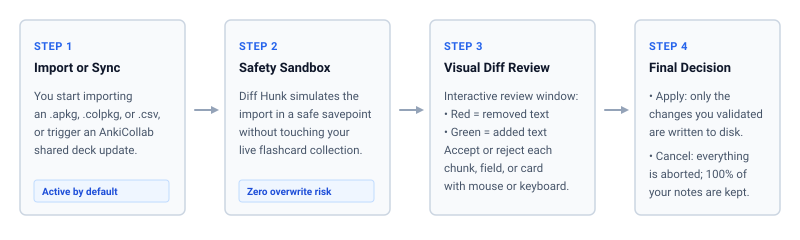
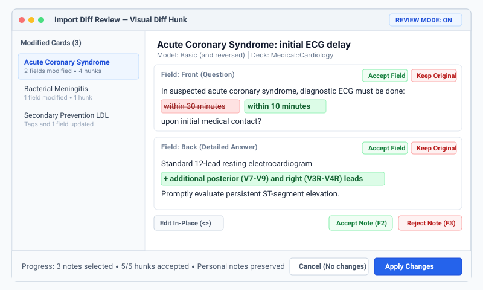
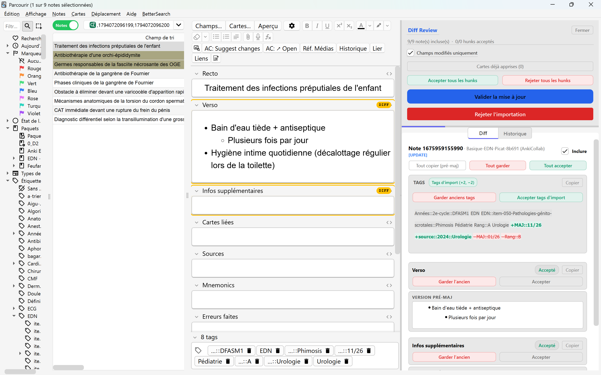
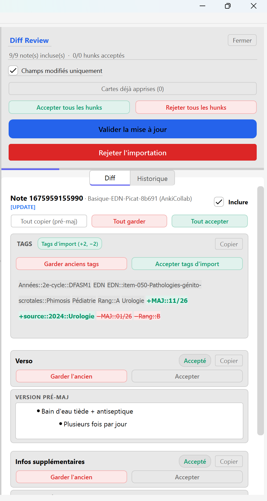

# Diff Hunk — Anki Import Diff Review & AnkiCollab Safety Gateway

Visual diff review, hunk-by-hunk decision controls, and safety sandbox for Anki package imports (`.apkg`, `.colpkg`, `.csv`) and AnkiCollab collaborative deck synchronizations.

> [!NOTE]
> **Non-Destructive Dry Run Guarantee**  
> Diff Hunk intercepts import operations in an isolated SQLite transaction savepoint. If you cancel or close the review dialog, zero changes are written to your database, leaving your collection completely untouched.

---

## Why Diff Hunk?

By default in Anki, importing a shared deck or updating a collaborative package blindly overwrites existing cards:
- **Personal notes and custom mnemonics** get silently wiped out.
- **Subtle rewrites or deletions** cannot be inspected before being saved.
- **All-or-nothing limitation**: There is no native way to adopt an updated question while keeping your custom explanation.

**Diff Hunk** resolves this by placing an interactive safety gateway between incoming files and your Anki database. It computes exact word-level and tag-level differences, renders them in a clear visual interface, and gives you total control over what is kept and what is merged.

---

## 4-Step Safety Workflow



1. **Import or Sync Trigger**: You initiate an import via `File > Import` (`.apkg`, `.colpkg`, `.csv`) or trigger an AnkiCollab shared deck sync.
2. **Safety Sandbox Execution**: Diff Hunk simulates the entire update inside a temporary SQLite transaction without modifying your active collection.
3. **Visual Granular Review**: The review dialog opens, displaying exact deltas:
   - **Green highlights**: Newly added text or updated tags.
   - **Red strikethrough**: Removed text or deleted tags.
4. **Selective Commit**: Only the modifications you explicitly approve are written to your database. If you abort, 100% of your pre-import collection is preserved.

---

## Interface Overview





---

## How to Use Diff Hunk

### 1. Granular Hunk-by-Hunk Review

Diff Hunk intelligently tokenizes text differences into atomic change hunks, avoiding false diffs caused by minor whitespace or self-closing HTML tag variations (`<br />` vs `<br>`):



- **Accept hunk (`[+]`)**: Adopts the incoming change. The hunk card highlights in soft green with a prominent green gutter.
- **Reject hunk (`[−]`)**: Keeps your local version. The hunk card displays a red gutter, retaining your original text.
- **Field-level actions**:
  - `Accept`: Batch-accepts all hunks in this specific field.
  - `Keep Original`: Batch-rejects all hunks in this specific field, preserving your existing notes.
- **In-place manual editing**: You are never locked into an all-or-nothing choice. Click into the editor and type freely to blend incoming official updates with your own notes before saving.

---

### 2. Tag Modifications Inspection

Tags are tracked independently from card content in a dedicated comparison panel in the dock:

- **Added tags**: Highlighted as green chips with a `+` badge.
- **Removed tags**: Rendered with red strikethrough styling and a `−` badge.
- **Accept tags only**: Want the new classification tags without touching your card's custom body text? Click *Accept import tags* or press `F4`.
- **Global tag setting**: The `accept_all_tags_on_confirm` configuration option automatically applies incoming tags on final confirmation while respecting your individual field/hunk choices.

---

### 3. High-Speed Keyboard Workflow (Review Mode)

Click **Mode Review** in the top-right header (or press `Tab`) to activate mouse-free triage:

| Shortcut | Action | Scope |
| :--- | :--- | :--- |
| `Tab` | Focus next change hunk | Dialog |
| `Shift + Tab` | Focus previous change hunk | Dialog |
| `Y` | **Accept** active hunk and auto-advance to next hunk | Dialog |
| `N` | **Reject** active hunk and auto-advance to next hunk | Dialog |
| `Space` | Toggle active hunk between accepted and rejected | Dialog |
| `F2` or `Alt + A` | **Accept all** changes for the current card | Dialog / Browser |
| `F3` or `Alt + R` | **Reject all** changes for the current card | Dialog / Browser |
| `F4` or `Alt + Shift + T` | **Accept tags only** for the current card | Dialog / Browser |
| `Down` / `Right` | Move to next modified note | Dialog |
| `Up` / `Left` | Move to previous modified note | Dialog |
| `Enter` | Commit and apply validated changes | Dialog |
| `Esc` | Abort import and keep collection unchanged | Dialog |

---

### 4. Anki Browser Dock (Card Explorer Integration)

Diff Hunk seamlessly integrates into Anki's native Card Browser (`Browse / Parcourir`):

- **Side-by-side dock**: Docks beside the standard note editor to inspect modifications during regular browsing.
- **Tabbed navigation**:
  - `Diff Hunk`: Shows pending or recent deltas with instant visual diff highlighting.
  - `Old Fields`: Displays the pre-update backup of your note.
  - `History & Collab`: Chronological log of past updates, synchronizations, and revisions.
- **Keyboard shortcuts in Browser**:
  - `Alt + H`: Toggle between the Diff view and the History & Collab tab.
  - `Alt + C`: Copy the pre-update content of the selected note to your system clipboard.
- **Focused filters**:
  - `Only changed fields`: Automatically collapses identical fields to show only modified content.
  - `Learned cards only`: Filters out untouched new cards so you only review flashcards currently in your active study queue.

---

### 5. AnkiCollab & Protected Fields

Diff Hunk provides first-class support for the official **AnkiCollab** add-on (ID `1957538407`):

- Automatically intercepts background synchronization runs before changes are committed.
- Detects protected fields configured in AnkiCollab. Protected fields display a distinct amber `Protected` badge and automatically default to rejected, guaranteeing your personal notes cannot be overwritten by upstream updates.

---

## Configuration Options

Access settings through `Tools > Add-ons > Diff Hunk > Config`:

```json
{
    "visual_diff_enabled": true,
    "ankicollab_diff_enabled": true,
    "only_changed_fields": true,
    "learned_cards_only": true,
    "accept_all_tags_on_confirm": true
}
```

- `visual_diff_enabled` (`boolean`, default: `true`): Enables the interactive diff review dialog when importing `.apkg`, `.colpkg`, or `.csv` files.
- `ankicollab_diff_enabled` (`boolean`, default: `true`): Intercepts remote sync batches from AnkiCollab.
- `only_changed_fields` (`boolean`, default: `true`): Hides unchanged fields in the diff view to minimize visual clutter.
- `learned_cards_only` (`boolean`, default: `true`): Filters review verification to cards with existing review history, bypassing untouched new cards.
- `accept_all_tags_on_confirm` (`boolean`, default: `true`): Pre-checks tag adoption on final confirmation.

---

## Compatibility

- **Anki Versions**: 23.10+, 24.x, 25.x+ (Qt6)
- **Operating Systems**: Windows, macOS, Linux
- **Ecosystem Integration**: Fully compatible with [AnkiCollab](https://ankicollab.com) and [Customize Keyboard Shortcuts](https://ankiweb.net/shared/info/353547840).

---

## Credits & License

- **Author & Maintenance**: [Ficello](https://github.com/Ficello)
- **Architecture & Automated Testing**: Designed, engineered, and test-covered with **Antigravity** (Google DeepMind).
- **Source Code**: [Ficello/Anki_Import_Diff_Review](https://github.com/Ficello/Anki_Import_Diff_Review)
- **AnkiWeb Listing**: [132168060](https://ankiweb.net/shared/info/132168060)
